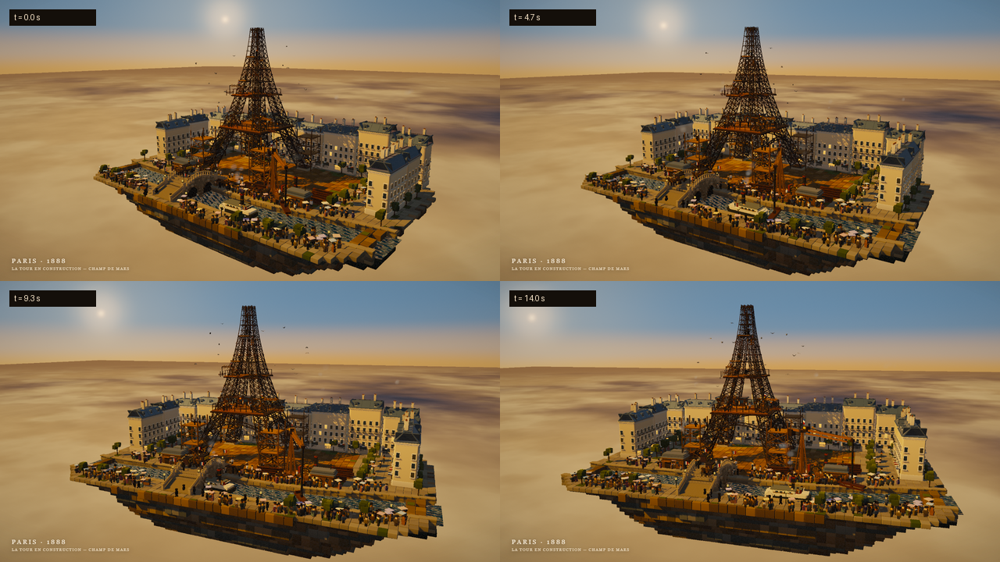

> [!IMPORTANT]
> **AI disclaimer:** This project is an AI-generated creative demo. Its code, shaders, procedural art, and documentation were produced with AI assistance (DeepSeek Harness) and may contain errors, inaccuracies, or unintended artifacts. Review and test it before relying on it or redistributing it. No warranty of any kind is provided.

# Voxel Paris 1888 — La Tour en Construction

**Voxel Paris 1888** is a single, self-contained three.js page: a floating voxel diorama of Paris in 1888 with the Eiffel Tower under construction. The animation is exactly 14 seconds long, designed for deterministic 1280 × 720 / 30 fps frame capture.



## Live page

**https://xbtmania.github.io/voxel-paris-1888/**

The repository is **`xbtmania/voxel-paris-1888`**. The deployable entry point is [`index.html`](index.html). A descriptive copy of the same self-contained page is also available as [`voxel-paris-1888.html`](voxel-paris-1888.html).

## What is in the scene

- **Floating island** with a jagged, layered rock underside, a curving Seine, stone quays, lamps, stairways, and an arched stone bridge.
- **Eiffel Tower under construction** — four flaring lattice legs with dense X-bracing, a finished first platform, a half-laid second level, an open top skeleton, timber scaffolding, creeper cranes, and girders hanging from chains.
- **Champ de Mars yard** with dirt tracks, girder stacks, wooden sheds, a steam engine with a smoking chimney, and construction workers.
- **Haussmann Paris** — cream facades, zinc mansard roofs, dormers, chimneys, lit windows, trees, kiosks, crowds, and a few tricolor flags.
- **Life and traffic** — hundreds of tiny voxel people, rivet teams and hammers, strolling onlookers with top hats and parasols, horse-drawn carts, bridge carriages, a smoking riverboat, and circling pigeons.
- **Look and finish** — 25° orbit, gentle push-in, warm late-afternoon sun, soft directional shadows, baked voxel ambient occlusion, atmospheric haze, rounded voxel geometry, ACES filmic tone mapping, and bloom on the brightest sparks and the sun.

This is an artistic interpretation of Paris in 1888, not a historically accurate reconstruction.

## Deterministic capture API

The page is built for frame-by-frame capture:

| Value / API | Meaning |
| --- | --- |
| `window.__ready` | `true` after the first frame is initialized. |
| `window.renderAt(t)` | Renders the exact frame at `t` seconds, `0 ≤ t ≤ 14`. Pauses autoplay so the frame stays on the canvas. |
| `window.__duration` | `14` seconds. |
| `window.__fps` | `30` (nominal animation rate). |
| `window.__width`, `window.__height` | Internal canvas resolution: `1280`, `720`. |
| `window.__pause()` / `window.__resume()` | Pause or restart autoplay. |
| `window.__lastError` | Any initialization/render error, if one occurred. |

Example capture flow:

```js
await new Promise((resolve) => {
  const poll = () => (window.__ready ? resolve() : setTimeout(poll, 50));
  poll();
});

window.renderAt(7.5);

// The final post-processed frame is in the canvas. preserveDrawingBuffer
// is enabled, so this works even outside the render callback.
const png = document.querySelector('#scene').toDataURL('image/png');
```

Clicking or interacting with the page is not required. Autoplay starts immediately; calling `renderAt()` takes over for deterministic captures.

## Run locally

The page has no network dependencies after it is built. Open `index.html` directly in any current desktop browser with WebGL2 support.

For a local server (optional):

```bash
python -m http.server 8000
# then open http://localhost:8000/
```

## Deploying to GitHub Pages

A Pages workflow is included at [`.github/workflows/pages.yml`](.github/workflows/pages.yml). It deploys only the prebuilt static files, so no Node or Python build is required on every deploy.

1. Push the repository to GitHub on the `main` branch.
2. Open **Settings → Pages**.
3. Under **Build and deployment**, set **Source** to **GitHub Actions**.
4. In the **Actions** tab, run the “Deploy static site to Pages” workflow manually if the first push happened before Pages was enabled. Future pushes to `main` deploy automatically.
5. The page is published at `https://xbtmania.github.io/voxel-paris-1888/` (or the custom domain configured for the repository).

For a simpler branch-based deployment, choose **Deploy from a branch**, select **`main`** and **`/ (root)`** instead. The root [`index.html`](index.html) and [`.nojekyll`](.nojekyll) are already in place.

## Rebuilding the generated pages

The generated HTML pages are committed for Pages, so rebuilding is only needed after editing the source.

Requirements: Python 3 and Node.js.

```bash
npm install
python build.py
```

`build.py` embeds the locally installed three.js runtime, `src/app.js`, and `src/index.template.html` into both output files, keeping them byte-identical.

## Project layout

```
index.html                          # GitHub Pages entry point (generated)
voxel-paris-1888.html               # Descriptive standalone copy (generated)
voxel-paris-1888-contact-sheet.png  # Preview image
build.py                            # Inlines three.js + app + template into both outputs
src/index.template.html             # HTML shell, CSS, title, error fallback
src/app.js                          # Three.js scene, shaders, animation, renderAt()
.github/workflows/pages.yml         # GitHub Actions Pages deploy
.nojekyll                           # Serve the static files verbatim on Pages
.gitignore                          # Keeps local dev/QA artifacts out of the repo
LICENSES/three.js-MIT.txt           # Third-party license for bundled three.js
```

Local-only material such as `node_modules/`, `shots/`, `preview_frames/`, and `qa/` is ignored by Git.

The generated output is completely self-contained: three.js, all geometry, shaders, canvas textures, and animation data are inline in one HTML file. No external images, fonts, scripts, or network requests are used.

## Technical notes

- Requires a WebGL2-capable browser. Rendering budget is approximately 1280 × 720 output with a 1.5× supersampled scene buffer.
- The scene is procedural; every visible asset is generated in code or drawn into offscreen canvases at runtime.
- The same timestamp always produces the same frame. The animation has no physics accumulation or wall-clock simulation inside `renderAt()`.
- HDR render targets gracefully fall back to LDR if the WebGL2 `EXT_color_buffer_float` extension is unavailable.
- The page is responsive: the 16:9 stage scales to small screens and is letterboxed on very large viewports. The internal animation resolution remains fixed at 1280 × 720.
- The page itself uses no analytics, cookies, local storage, or third-party requests; it is entirely offline after loading the single HTML file.

## Credits, licensing, and AI assistance

- **three.js r128** is bundled as an inline library. three.js is © 2010–2021 three.js authors and is distributed under the MIT License; the full text is in [`LICENSES/three.js-MIT.txt`](LICENSES/three.js-MIT.txt).
- All scene content, custom shaders, and code were generated for this project with AI assistance.
- No license has been specified for this project’s original code and art. Add a license file if you intend to allow reuse. (The bundled three.js remains MIT-licensed.)
- This is an independent creative project, not affiliated with or endorsed by any company, museum, or historical institution.

For feedback or fixes, open an issue or submit a pull request. Please include the timestamp and a screenshot when reporting a visual problem.
